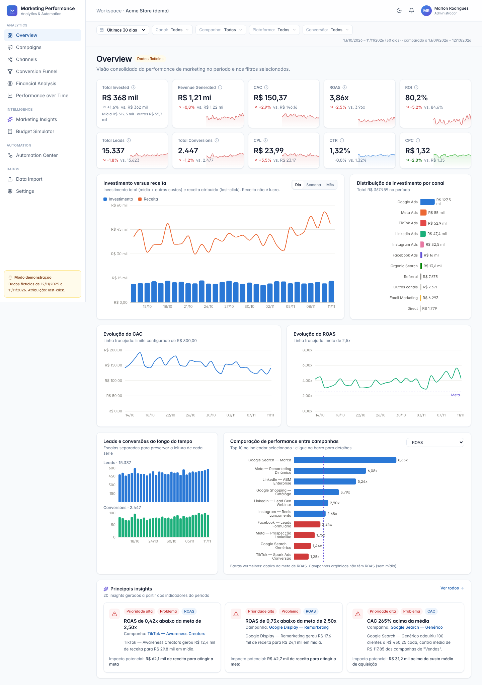
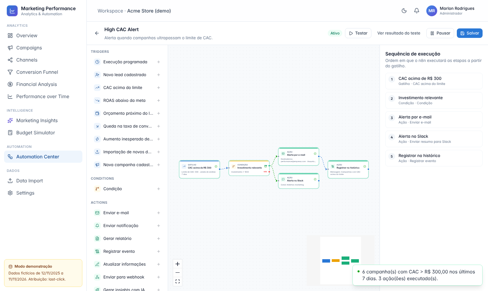
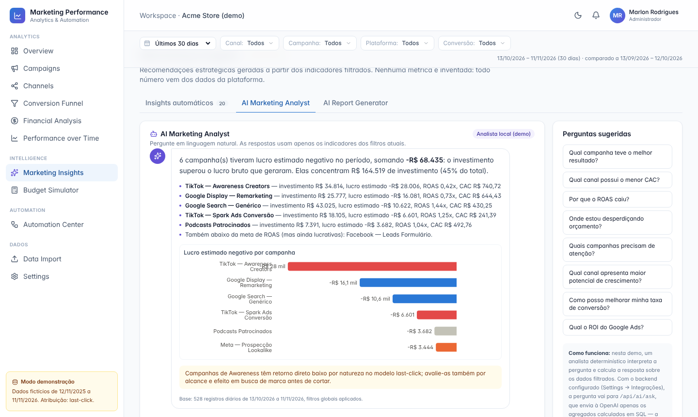
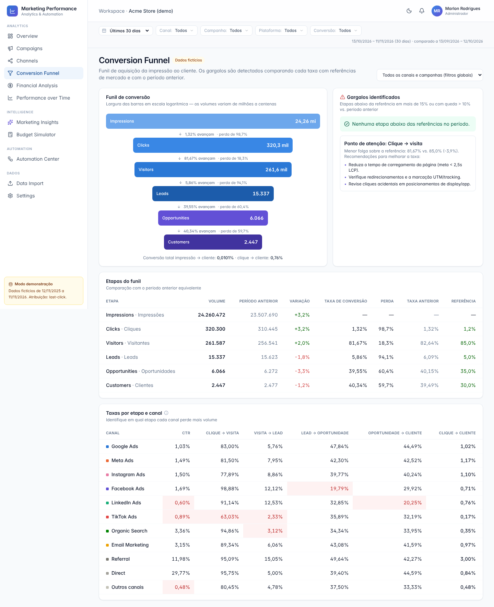
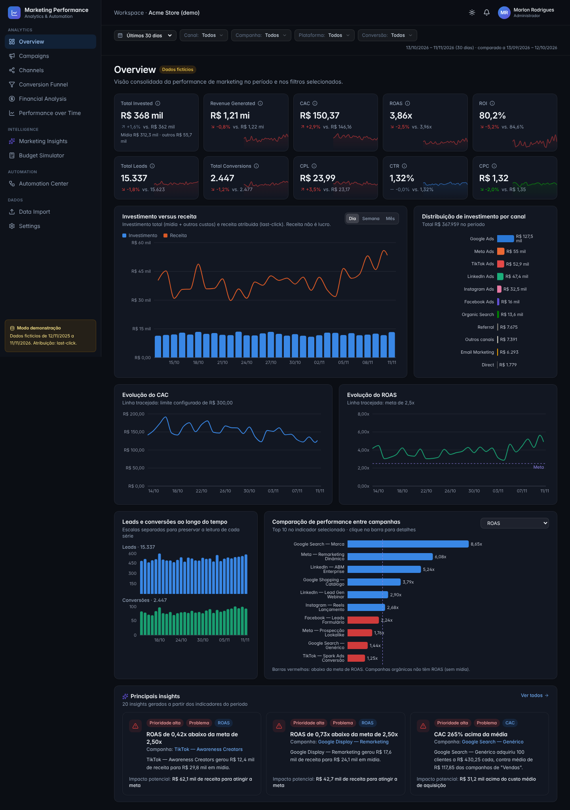
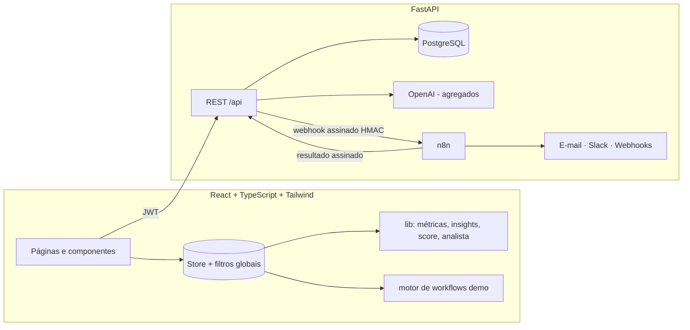

# Marketing Performance Analytics

Plataforma SaaS de **Marketing Analytics, Marketing Intelligence e Marketing Automation**: monitora campanhas e canais, calcula CAC, ROAS, ROI e funil com fórmulas auditáveis, gera insights a partir dos dados e executa workflows de automação integrados ao **n8n**.

> Projeto de portfólio. **Todos os dados exibidos são fictícios**, gerados de forma determinística (12 meses, 19 campanhas, 11 canais).

**Demo:** https://marlonrodrigues120-creator.github.io/marketing-performance-analytics/
Contas de demonstração (senha `demo123`): `admin@demo.com` (administrador) · `analista@demo.com` (analista) · `leitor@demo.com` (somente leitura).



## O que a aplicação faz

| Módulo | Destaques |
|---|---|
| **Overview** | 10 KPIs com variação vs. período anterior, tendência contextual (CAC caindo = positivo), tooltip com fórmula e sparkline; investimento × receita, evolução de CAC/ROAS com metas, leads e conversões, distribuição por canal, ranking de campanhas |
| **Filtros globais** | Período (presets e personalizado), canal, campanha, plataforma e tipo de conversão — aplicados uma única vez (`useAnalytics`) e consumidos por todas as páginas, garantindo cards, gráficos, tabelas e insights consistentes |
| **Campaigns** | Tabela com 15 indicadores, ordenação, pesquisa, filtros, exportação CSV, melhores/piores campanhas e página de detalhe com histórico, comparação com a média do mesmo objetivo e insights específicos |
| **Campaign Score** | Nota 0–100 por campanha com metas e pesos **por objetivo** (Vendas, Geração de leads, Awareness), configuráveis, e explicação dos fatores |
| **Channels** | Líderes por indicador, comparativo, ranking de eficiência (percentis de ROI, CAC, CPL, conversão e ROAS) e comparação lado a lado de 2+ canais |
| **Conversion Funnel** | Impressões → cliques → visitantes → leads → oportunidades → clientes, perdas por etapa, comparação com período anterior, detecção automática de gargalos vs. referências e recomendações; por canal e campanha |
| **Financial Analysis** | Da receita ao lucro estimado (margem bruta configurável), rentabilidade por canal/campanha e as fórmulas aplicadas com os valores do período |
| **Performance over Time** | Séries diárias/semanais/mensais, sobreposição do período anterior e tendência por regressão linear |
| **Marketing Insights** | 10 regras (CAC acima da média, ROAS abaixo da meta, alta de CPC, queda de conversão, redistribuição de orçamento…) com evidências, impacto e prioridade |
| **AI Marketing Analyst** | Perguntas em linguagem natural respondidas com números reais, gráficos de apoio e ressalva explícita quando há só correlação; com backend, usa a OpenAI com contexto agregado em SQL |
| **AI Report Generator** | Relatório executivo do período (copiar, Markdown, imprimir/PDF) |
| **Budget Simulator** | Redistribuição de mídia com retornos decrescentes (elasticidade β), sugestão automática, cenários salvos — projeções sempre separadas de resultados reais e sem alterar plataformas sem confirmação |
| **Automation Center** | KPIs de automação, CRUD de workflows, ativar/pausar, teste manual, histórico, logs, 6 modelos obrigatórios + 2 de IA |
| **Workflow Builder** | Editor visual de nós (React Flow): gatilhos, condições AND/OR com saídas SIM/NÃO, ações, validação (gatilho único, nós desconectados, ciclos), teste com status por nó |
| **Data Import** | CSV com detecção de colunas, mapeamento, validação (datas, números pt-BR/en, negativos), duplicidades (no arquivo e na base), valores ausentes, confirmação, histórico e reversão |
| **Settings** | Metas, margem, atribuição, score, integrações (teste de conexão com a API), RBAC e reset da demo |

| | |
|---|---|
|  |  |
|  |  |

## Fórmulas e regras de negócio

| Indicador | Fórmula |
|---|---|
| CAC | Investimento total ÷ novos clientes |
| CPL | Investimento total ÷ leads |
| ROAS | Receita atribuída ÷ investimento em anúncios (mídia) |
| ROI | ((Lucro bruto − Investimento total) ÷ Investimento total) × 100, com lucro bruto = receita × margem |
| CTR | (Cliques ÷ Impressões) × 100 |
| CPC | Investimento em anúncios ÷ cliques pagos |
| Conversion Rate | (Conversões ÷ Cliques) × 100 |
| Average Order Value | Receita ÷ pedidos |

- **Investimento total** = mídia + custos não-mídia (produção, ferramentas, comissões, agência), registrados por campanha/dia. CAC e ROI usam o total; ROAS e CPC usam só mídia.
- **Receita não é lucro**: ROI parte do lucro bruto; um ROAS > 1 pode ter ROI negativo (a tela financeira mostra o ROAS de break-even).
- **Divisão por zero** retorna `null`, exibido como “—” (ex.: ROAS de canal orgânico).
- **Atribuição**: last-click, documentado na interface. Modelos first-click/linear dependem de dados de jornada (GA4/CRM) no backend.
- Insights descrevem associações observadas e recomendam investigação — não afirmam causalidade.

## Arquitetura



- **Modo demonstração (GitHub Pages)**: sem backend, tudo roda no navegador — dados determinísticos, motor local de workflows (mesmas regras e dados; e-mail/Slack simulados), persistência em `localStorage`.
- **Modo completo**: `docker compose` sobe PostgreSQL, API e n8n. O app guarda definições, histórico e usuários; o n8n executa agendamentos, condições e envios. Chamadas nos dois sentidos são assinadas com **HMAC-SHA256 + timestamp** (anti-replay), execuções têm **chave de idempotência única** e falhas ficam registradas em `automation_logs`. Nenhum segredo chega ao frontend.

### Modelo de dados (PostgreSQL)

`users`, `marketing_channels`, `campaigns`, `budgets`, `marketing_metrics` (fato campanha × dia), `leads`, `conversions`, `revenue`, `funnel_daily`, `workflows`, `workflow_executions`, `automation_logs`, `ai_insights`, `integrations`, `data_imports` e a view `vw_campaign_daily`. DDL completo em [`backend/db/schema.sql`](backend/db/schema.sql).

## Estrutura

```
src/
  data/          gerador da base demonstrativa e tipos
  lib/           métricas, KPIs, insights, score, analista de IA, relatório
  automation/    catálogo de nós, modelos, motor de execução e validação
  store/         estado global, filtros, configurações
  components/    UI, gráficos, layout
  pages/         uma página por módulo
backend/
  app/           FastAPI: rotas, segurança, serviços (métricas, n8n, IA, importação), seed
  db/schema.sql  modelo relacional
  tests/         pytest
n8n/workflows/   6 workflows de referência para importar no n8n
```

## Como rodar

**Frontend (modo demo)**

```bash
npm install
npm run dev        # http://localhost:5173
npm test           # testes de fórmulas, consistência dos dados e automação
npm run build
```

**Ambiente completo**

```bash
cp backend/.env.example backend/.env       # preencha os segredos
docker compose up -d                       # PostgreSQL :5432, API :8000, n8n :5678
docker compose exec api python -m app.seed # carrega a mesma base fictícia
```

Depois, importe `n8n/workflows/*.json` no n8n, configure as credenciais de SMTP/Slack lá e informe `http://localhost:8000` em **Settings → Integrações**. Documentação da API em `http://localhost:8000/api/docs`.

`npm run export:demo` regenera `backend/seed/demo.json.gz` a partir do gerador do frontend, para que API e interface mostrem os mesmos números.

## Stack

React 19 · TypeScript · Vite · Tailwind CSS · Recharts · React Flow · PapaParse · Vitest — FastAPI · SQLAlchemy · PostgreSQL · pandas · pytest · n8n · OpenAI API · Docker · GitHub Actions (CI + Pages).

---
Desenvolvido por Marlon Rodrigues como case de portfólio para vagas de Data Analyst, BI Analyst, Marketing Data Analyst, BI Developer e Analytics Engineer.
